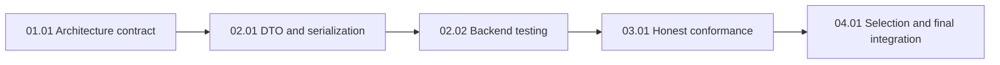

# TypeScript Backend Rule Expansion

## Outcome

Make operation-first modules the default TypeScript backend guidance, with separate compact DTO/serialization and backend-testing rule owners. Keep controllers, services, and data functions responsible for distinct concerns; allow a direct controller → data path only for reads without business policy, authorization-sensitive decisions, or orchestration. Bind only relevant directives and prove every blocking enforcement claim with a real check or named human evidence.

This is a **planning artifact**. It does not authorize implementation or claim any host application is compliant. `plan-review` and the developer checkpoint precede execution.

## Pre-planning record

### Source and current-state evidence

- Released `docs/discovery/typescript-backend-rule-expansion/brief.md` validates against record hash `sha256:e5fba2ae90ab802c020a720c3e38c39f848f8e82d7f94136b5359d097a6ca21d` and confirmed context hash `sha256:37bcd9dd4f31196593fb2b19a29baf455e73e9878b31562f460a580dcff721b0`.
- ADR 0001 and `rules/typescript/backend/module-architecture.md` currently prescribe layer folders; `controllers-and-routes.md` and `service-layer.md` have overlapping service/read wording.
- `rules/typescript/common/runtime-validation.md` owns boundary parsing and `rules/typescript/database/testing-data-access-layer.md` owns adapter tests. New rules must reference these owners instead of copying them.
- `orchestrator/conformance/adapters/typescript.mjs` has specific dispatch for a subset of IDs and a generic `heuristic-pass` fallback. `orchestrator/conformance/evidence-gate.mjs` currently accepts a PASS with a verifierType, so unhandled automated IDs can look enforced.
- `orchestrator/rules/binding-compiler.mjs` and `scripts/context-core.mjs` select directives by stack and affected file path. `evals/tests/rules/rule-binding.test.mjs` and `code-generation-evaluation.test.mjs` provide relevant selection/payload seams.
- `context-manifest.json`, `context-lock.json`, `docs/Rules.md`, and `docs/decisions/README.md` are synchronized catalog consumers; `evals/tests/rules/catalog-coverage.test.mjs` pins counts that must be updated from actual catalog output, never guessed.

### Actors and goals

| Actor | Goal and authority |
| --- | --- |
| Host backend developer | Get usable operation-specific rules from a short task request and affected files. |
| Factory maintainer | Own canonical rules, selection, verifier dispatch, examples, and inventory synchronization. |
| Human maintainer/reviewer | Supply named evidence or governed waivers for evidence-blocking directives and approve the reviewed execution packet. |

### Domain language and boundaries

An **operation folder** owns one use case inside a capability module. A **controller** parses transport input and serializes public output. A **service** owns business policy, authorization-sensitive decisions, orchestration, and transaction ownership. A **data function** owns persistence/remote mechanics. A **DTO** describes transport input or output, distinct from domain values and persistence rows. The module `index.ts` is the cross-module public import surface. Source definitions and scenario details are in the released discovery brief; the units copy the facts needed for cold starts.

### Language stack and applicable rules

- **Declared stack:** TypeScript rules for host backends; Context Factory implementation is Node ESM.
- **Planning source hashes:** `rules/global/evidence-and-claims.md` `sha256:ed699151d7d034cb2ce4b00fbf10236fd8bf2b7f701761d4f6f17bc7486d88af`; `rules/global/architecture-conformance.md` `sha256:ebd1818f58e6c3421d803fae8905b2077036fe7eec8e228cc6130066cd95af92`; `rules/typescript/common/runtime-validation.md` `sha256:d98e20e59fbe3b8b94e0498618d08a7d4d049a5ef53cfee38fd44c5bedcf3311`. Each unit binds its narrower applicable subset with directive IDs, modes, paths, and hashes.
- **Execution receipt:** `context-cli preflight` must compile a fresh binding for each changed scope; `context-cli conform` must produce a content-matched PASS before any unit/phase completion. Planning hashes are not execution receipts. Evidence-blocking directives require named human evidence; no agent self-attestation or waiver is assumed.
- **Precedence:** Applicable language and global rules supersede contradictory plan steps.

### Scenario coverage and acceptance trace

| Scenario | Expected outcome | Acceptance |
| --- | --- | --- |
| Create with policy and two writes | Input parsed once; service injected; both writes share transaction; public response serialized | AC-01, AC-03, AC-04 |
| Simple list/get | Controller may call data directly; bounded query and safe response; no pass-through service | AC-01, AC-02 |
| Tenant-sensitive read | Trusted service/policy decision prevents direct read bypass | AC-02, AC-06 |
| Internal row gains a field | Serializer omits it and contract test detects accidental exposure | AC-03 |
| Invalid cursor/body or mid-command failure | Structured safe error; transaction rolls back; retry does not duplicate effects | AC-03, AC-04 |
| Cross-module deep import, sideways import, bad suffix | Real architecture/path check fails or blocking evidence is required | AC-05 |
| Existing `src/features/` or `.spec.ts` host | Explicit compatibility keeps rule and test selection while `src/modules/` and `.test.ts` remain defaults | AC-01, AC-07 |
| Rule catalog or source changes | Binding, lock, and receipts refresh; payload size and behavior are separately checked | AC-05, AC-07, AC-08 |

### Decision ledger

| ID | Decision | Evidence and tradeoff | Implemented by |
| --- | --- | --- | --- |
| D-01 | Operation-first folders replace layer folders as default; retain layer responsibility via suffix and import direction. | User confirmation; new ADR must supersede ADR 0001 rather than silently rewrite history. | 01.01 |
| D-02 | Backend gaps first; DTO/serialization and backend-testing rules are separate compact owners. | User confirmation; avoids repeating common runtime validation and data-adapter tests. | 02.01, 02.02 |
| D-03 | Simple reads may use controller → data only without policy/orchestration; commands and sensitive reads use a service. | User confirmation; tenant-sensitive negative case prevents a policy bypass. | 01.01, 04.01 |
| D-04 | `.test.ts` and `src/modules/` are defaults; support established `.spec.ts` and `src/features/` hosts explicitly. | Current selector/test globs; avoids two implicit defaults and abrupt host breakage. | 02.02, 04.01 |
| D-05 | Automatable path/import checks get ID-specific verification; all unhandled automated IDs fail closed. Semantic constraints use named evidence until proven automatable. | ADR 0029; generic heuristic PASS is observed current behavior. Missing tools may block rather than silently pass. | 03.01 |

### SOLID boundary audit

| Principle | Boundary and plan consequence |
| --- | --- |
| SRP | Operation folder co-locates a change, while DTO, controller, service, data, and serializer retain distinct reasons to change. Architecture and contract tests cover role separation. |
| OCP | New operation files and stable module public surface extend a feature without editing unrelated operations or introducing a generic manager. |
| LSP | Data/transaction dependencies are substitutable contracts; fake and real data implementations must return the same domain-oriented result/error shape. |
| ISP | Public `index.ts` exposes a small needed contract, never broad internal layers; service dependency interfaces contain only operations the use case consumes. |
| DIP | Service policy owns dependency contracts and receives data/transaction adapters; no ORM/HTTP object enters a policy service. |

## Unknowns and blockers

None for planning. The exact implementation of path/alias resolution must meet AC-05; if it cannot, the affected directive remains evidence-blocking or reports unavailable, and the execution unit stops for review. No new third-party dependency is presumed.

## Acceptance criteria

| ID | Source goal/scenario | Binary criterion | Unit | Verification command or inspection | Status |
| --- | --- | --- | --- | --- | --- |
| AC-01 | D-01, simple create/read | Superseding ADR and module rule specify operation-first default, module-root sharing, public `index.ts`, names, and explicit `src/features` compatibility without conflicting current rules. | 01.01 | `node --test evals/tests/rules/backend-module-architecture.test.mjs` | planned |
| AC-02 | D-03, tenant read | Rule examples and tests allow direct data for policy-free reads, require service for policy-bearing reads and commands, and reject cross-tenant bypass. | 01.01 | `node --test evals/tests/rules/backend-module-architecture.test.mjs` | planned |
| AC-03 | DTO divergence/invalid input | Separate DTO/serialization rule states per-operation input/output and explicit mapping; a test fails if an internal field reaches public response or malformed input reaches domain logic. | 02.01 | `node --test evals/tests/rules/backend-dto-serialization.test.mjs` | planned |
| AC-04 | Transaction/retry | Service guidance and contract cases show injected transaction context, rollback after second-write failure, and safe external effect ordering. | 01.01, 02.01 | `node --test evals/tests/rules/backend-module-architecture.test.mjs evals/tests/rules/backend-dto-serialization.test.mjs` | planned |
| AC-05 | Import/name abuse, false PASS | Bad/good structural fixtures fail/pass via an ID-specific verifier; an unhandled automated directive never returns heuristic PASS or makes report PASS without valid evidence. | 03.01 | `node --test evals/tests/conformance/typescript-adapter.test.mjs evals/tests/conformance/conformance-gate.test.mjs` | planned |
| AC-06 | Test ownership and tenant negative case | Backend-testing rule covers service/controller/data/route/public-contract cases with appropriate test types and no duplicate adapter-test policy. | 02.02 | `node --test evals/tests/rules/backend-testing.test.mjs` | planned |
| AC-07 | Minimal input, host compatibility | Scoped binding includes backend rules for `src/modules` and explicit established `src/features` hosts, recognizes `.test.ts`/`.spec.ts`, excludes unrelated UI/framework rules, and records rendered prompt size against baseline. | 04.01 | `node --test evals/tests/rules/rule-binding.test.mjs evals/tests/rules/code-generation-evaluation.test.mjs` | planned |
| AC-08 | Catalog lifecycle | ADR/rules/map/manifest/lock agree; named tests, lint, evaluations, doctor, and final whole-diff conformance run with recorded outcomes. | 04.01 | `npm run lint && node evals/run-evals.mjs && node scripts/context.mjs doctor` | planned |

## Scope

- Canonical backend TypeScript rules and a superseding architecture decision; tightly related controller, service, runtime-validation, and data-testing wording only where needed to remove contradiction.
- Rule selection, conformance adapter behavior, focused fixtures/tests, catalog inventory/maps/lock, and representative prompt/code quality evaluation.
- No host application code, schema, deployment, editor setup, or unrelated UI/common rule expansion.

## Non-goals

No mandatory ORM, DTO library, `src/platform/` directory, domain-event bus, scaffold generator, or hard 15-operation split threshold. No database migration or host module migration. Do not convert existing archived task records into current policy. Do not claim token savings imply generated-code correctness.

## Risk and dependency register

| Risk or dependency | Impact | Mitigation / owner |
| --- | --- | --- |
| Current ADR 0001 remains accepted | Old/new layouts conflict | 01.01 adds a superseding ADR and updates the decision index. |
| Direct reads conceal tenant policy | Authorization bypass | 01.01 negative case and 02.02 testing matrix require service/policy boundary. |
| Generic fallback accepts fake verifierType | False PASS | 03.01 tests the report verdict, not only adapter status; fail closed. |
| New directives grow prompt | More model input | 04.01 measures rendered payload for fixed create/read requests and removes duplicated owners; report delta even if not improved. |
| Rule/catalog files change between units | Stale hashes/receipts | Refresh manifest/lock and preflight after each catalog-changing unit; final whole-diff check. |
| Host uses alias imports or alternate roots | False positive or missed rule | Unresolved aliases require host tool/evidence rather than guessed compliance; explicit host convention cases in 04.01. |

## Task branch

| Field | Verified state |
| --- | --- |
| Target branch | `master` |
| Task branch | `feat/PLN-0007-typescript-backend-rule-expansion` |
| Base commit | `a1ffd01afeaff61e1ec2f649e60d23a51ed313a9` |
| Base verification | Remote `master` matched `origin/master` at `094f05b6e878cdb94aef53e575cd86a76815c11f`; local base adds only the user-authorized discovery commit. |
| Git model | One task branch; units execute serially, with no unit branches/worktrees. |

## Phases and dependency graph

| Phase | Goal | Units | Checkpoint |
| --- | --- | --- | --- |
| 01 — Architecture contract | Supersede the old shape and harmonize route/service/data boundaries. | 01.01 | ADR and architecture cases reviewed. |
| 02 — Contract rule owners | Add focused DTO/serialization and backend-testing guidance with catalog synchronization. | 02.01 → 02.02 | Focused contract tests and map/lock integrity. |
| 03 — Enforcement | Make backend structural checks and generic automated fallback honest. | 03.01 | Bad/good fixtures and fail-closed report tests. |
| 04 — Integration | Prove selection, payload, behavior, catalog health, and whole-task handoff. | 04.01 | Full required checks and final review. |

The units are serial because later checks use rule IDs and catalog state established by earlier units, and catalog sync files are shared. No same-phase units are logically independent after inventory synchronization. A separate session can execute any unit from its own file after its `depends_on` requirements pass.

## Verification

Planning: released brief and source hashes verified; task branch and base verified. `node scripts/context.mjs plan:check docs/tasks/2026/10/2026-10-10/feat-PLN-0007-typescript-backend-rule-expansion --json` passed with five units, no graph conflicts, and valid rule bindings, done-check, and handoff. Execution-time checks are specified per unit and remain **not run**. `doctor` run by the discovery commit hook was HEALTHY at v5.0.0 with 32/32 evaluations; it does not prove this plan's outcome.

## Deviations

The scaffold placed its master task file beside the task directory. It was moved into this directory as `README.md` so `plan:check` can find the v3 task contract and released brief.

## Plan done-check

- [x] Acceptance criteria map to unit IDs and concrete verification commands.
- [x] Blockers are resolved or absent; implementation details have owners and stop conditions.
- [x] Risks and dependencies are recorded, including rollout and recovery.
- [x] Task branch and target base are verified and recorded in every unit.

## Finalization & Merge Ledger

| Stage | Branch / path | Required evidence | State |
| --- | --- | --- | --- |
| Plan review | `feat/PLN-0007-typescript-backend-rule-expansion` | `plan:check` PASS, independent `/plan-review`, developer approval | pending |
| Each unit | same task branch | failing test first for behavior changes, focused tests, `/review`, fresh preflight and whole-unit conformance PASS with named human evidence | pending |
| Phase checkpoints | same task branch | phase tests, lock and map synchronization, developer checkpoint | pending |
| Task finalization | task branch → `master` | full acceptance checks, `npm run lint`, `node evals/run-evals.mjs`, `node scripts/context.mjs doctor`, final whole-diff conformance PASS, verified ledger, clean review | pending |
| Integration | `master` | merge only after approved checkpoint; verify post-merge Git state and doctor; no remote push implied | pending |

## Result

Planning only. Implementation, review packet, conformance receipts, and integration remain pending.
