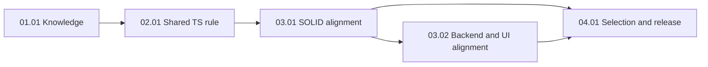

# TypeScript Pragmatic Design Principles and Rule Alignment

## Outcome

Add canonical knowledge for YAGNI, KISS, composition over inheritance, and one combined Law of Demeter / tell, don't ask concept. Bind concise guidance to TypeScript and TSX files and reconcile existing rules so a present need drives abstractions, strategies, and file splits. Preserve authorization, tenant, data integrity, transport, and persistence boundaries. This is a plan; it does not implement the new guidance.

## Pre-planning record

- The released `docs/discovery/pragmatic-design-principles-and-rule-alignment/brief.md` is valid, ready for planning, and contains no material unknowns. Its SHA-256 is `6fb49a8504025e2b5a0728973e663562fc227bcc62769075d59b5705ac96df2b`. Grounding packet G-00..G-05 identifies current canonical claims and conflicting directives.
- Local `master` was fast-forwarded to verified PLN-0007 commit `298768ee210189f2f2221f3cf8f041bce2ad26bf`; post-merge doctor was HEALTHY. This branch was created from that clean commit. `origin/master` was not pushed.
- Current `rules/solid/open-closed.md` requires polymorphic strategies and stable extension interfaces; `rules/solid/single-responsibility.md` requires distinct files and React hook extraction; `rules/solid/dependency-inversion.md` requires ports and adapters. Their `appliesTo` globs are TypeScript and TSX despite `stack: global`.
- `rules/global/code-quality.md` and `rules/global/architecture-conformance.md` summarize SOLID for all stacks. `rules/typescript/backend/service-layer.md` already permits a policy-free simple read without a pass-through service. `rules/typescript/ui/code-organization.md` promotes shared code on actual reuse. ADR 0037 makes operation-first backend folders the default with established-host layer-folder compatibility.
- `knowledge/principles/` currently contains only SOLID notes. `docs/Wiki.md`, `knowledge/README.md`, `docs/Rules.md`, `context-manifest.json`, and `context-lock.json` are catalog consumers. `orchestrator/rules/binding-compiler.mjs` and `scripts/context-core.mjs` bind directives by stack and affected path; `orchestrator/conformance/adapters/typescript.mjs` must not report unimplemented automation as a pass.

### Actors and domain language

| Actor | Goal |
| --- | --- |
| TypeScript host developer | Get small, applicable design guidance without speculative structure. |
| Factory maintainer | Keep knowledge, rules, metadata, maps, and selection consistent. |
| Human reviewer | Judge subjective boundaries with named evidence when a verifier cannot prove them. |

YAGNI rejects structure for hypothetical requirements. KISS selects a clear, complete implementation for the current requirement. Composition over inheritance chooses collaborator behavior over subclass coupling when variation is real. The combined Law of Demeter / tell, don't ask check keeps a decision with the owner of the data and avoids reaching through internals; it permits legitimate DTO reads, validation, serialization, and pure transforms.

### Language and rule binding

- Declared stack: TypeScript and TSX only. New common rules apply through affected-file paths and nearest package metadata, not request wording alone. Plain JavaScript and unrelated stacks are negative cases.
- Planning source hashes: `rules/global/evidence-and-claims.md` `sha256:ed699151d7d034cb2ce4b00fbf10236fd8bf2b7f701761d4f6f17bc7486d88af`; `rules/global/code-quality.md` `sha256:953a9cc78d05e2ea55c2dce6dc259ab34c330cf3b5e94efc135105acd8833dce`; `rules/global/architecture-conformance.md` `sha256:ebd1818f58e6c3421d803fae8905b2077036fe7eec8e228cc6130066cd95af92`.
- Each unit binds a narrower directive subset. Execution must compile a fresh binding with `context-cli preflight` for the exact changed scope. Planning hashes do not substitute for a conformance receipt. Subjective directives use advisory mode or named human evidence; no directive may claim automated enforcement without an ID-specific good/bad verifier.

## Acceptance criteria

| ID | Scenario / decision | Binary criterion | Unit | Verification |
| --- | --- | --- | --- | --- |
| AC-01 | Distinct YAGNI and KISS | Four canonical notes have valid metadata, TypeScript examples, counterexamples, documented exceptions, and Wiki/index links; YAGNI and KISS have distinct definitions. | 01.01 | `npm run lint`; `node scripts/context.mjs doctor` |
| AC-02 | One implementation, real variants | Shared TypeScript rule accepts a direct one-implementation design and allows a focused composed strategy for present variation without mandating inheritance, interface, registry, or file split. | 02.01 | `node --test evals/tests/rules/pragmatic-design.test.mjs` |
| AC-03 | Reach-through decision | One combined directive rejects a caller that reads nested state to decide an owner's action; permits DTO reads, parsing, serialization, and pure transforms. | 02.01 | `node --test evals/tests/rules/pragmatic-design.test.mjs` |
| AC-04 | Existing conflicting rules | OCP, SRP, and DIP directives/knowledge no longer mandate speculative strategies, universal file separation, hook extraction, or ports for one concrete collaborator; stable IDs and trust boundaries remain. | 03.01 | `node --test evals/tests/rules/pragmatic-solid-alignment.test.mjs` |
| AC-05 | Backend/UI consistency | Backend simple read remains direct only without policy; tenant-sensitive reads keep trusted policy. UI co-location and framework composition stay contextual; global changes do not alter plain-JavaScript selection. | 03.02 | `node --test evals/tests/rules/pragmatic-backend-ui-alignment.test.mjs` |
| AC-06 | Scope and rendered guidance | Relevant `.ts`/`.tsx` paths bind the shared rule once, nearest-package React/Next.js/SolidJS additions stay scoped, and plain JavaScript/unrelated stacks do not bind it. Provider payload contains selected statements. | 04.01 | `node --test evals/tests/rules/rule-binding.test.mjs evals/tests/rules/code-generation-evaluation.test.mjs` |
| AC-07 | Honest enforcement | Missing verifier or named evidence cannot yield a blocking PASS; only an ID-specific good/bad verifier may support automated-blocking. | 04.01 | `node app/cli/bin/context-cli.mjs conform` with no evidence and named evidence; `node --test evals/tests/conformance/typescript-adapter.test.mjs` if changed |
| AC-08 | Catalog and finalization | Manifest, maps, version, lock, tests, evaluations, doctor, and whole-diff conformance agree; completion distinguishes factory health from host correctness. | 04.01 | `npm run lint`; `node evals/run-evals.mjs`; `node scripts/context.mjs doctor`; `node app/cli/bin/context-cli.mjs conform verify` |

## Decision ledger and SOLID boundary audit

| ID | Decision and evidence | Plan consequence |
| --- | --- | --- |
| D-01 | User chose defaults with justified exceptions on 2026-10-10; a hypothetical future variant is insufficient. | YAGNI and KISS remain distinct; rules state a current-need trigger. |
| D-02 | User limited scope to TypeScript/TSX and requested one combined Demeter/tell-don't-ask check. | One common rule owner; tests include JavaScript exclusion and DTO exceptions. |
| D-03 | ADR 0037 preserves operation-first default and established-host layer folders; PLN-0007 deferred structural verifiers. | Reconcile wording without weakening trusted policy or claiming automated structural proof. |
| D-04 | SRP: cohesive responsibility can share a file. OCP: extension points need observed variation. DIP: a real policy-to-infrastructure boundary can use a narrow contract. LSP/ISP: new contracts stay substitutable and small. | Separate knowledge, shared rule, SOLID reconciliation, and backend/UI reconciliation; review dependency direction in 03.01/03.02. |

## Unknowns and blockers

No material product choice remains. Exact directive IDs and whether a selector defect exists are execution decisions gated by failing tests. If changing a global directive would alter plain-JavaScript behavior, preserve it and express the TypeScript exception in a TypeScript-scoped owner; record the resolution. No third-party parser, framework, host migration, or automatic verifier is assumed.

## Scope and non-goals

In scope: canonical principle knowledge, one TypeScript common rule, targeted SOLID and backend/UI rule reconciliation, selected knowledge examples, contract/selection/conformance tests, and catalog/lock/version synchronization. Optional selector or adapter changes require a failing integration test and a unit scope amendment before editing.

Out of scope: host application source, JavaScript-only or other-stack guidance, schema/data migrations, deployment, mandatory framework or strategy registry, and implementation of the deferred PLN-0007 structural verifier. No public API or runtime dependency is planned. Rollback is a task-branch revert of knowledge, rule, test, and catalog commits together.

## Risk and dependency register

| Risk or dependency | Impact | Mitigation / owner |
| --- | --- | --- |
| `stack: global` SOLID rules have TypeScript path globs | Edits may affect unexpected hosts | 03.01 checks `.ts`/`.tsx` binding and preserves current IDs/modes where contracts remain. |
| Global quality and architecture summaries may bind JavaScript | A TypeScript exception could leak across stacks | 03.02 tests JavaScript before/after binding; use the TypeScript owner when a global edit cannot be scoped. |
| New subjective directives have no structural verifier | False automated PASS or evidence bypass | 02.01 uses evidence-blocking/advisory modes; 04.01 tests missing/named evidence and receipt verification. |
| Shared catalog files span 03.01 and 03.02 | Concurrent edits conflict or leave stale lock | 03.02 executes after 03.01 and resynchronizes manifest/lock. |
| New common guidance expands every TypeScript payload | Latency/input cost may grow | 04.01 measures exact rendered JSON bytes and narrows duplicated text without inventing a target. |

## Dependencies and phases

The rule-owner changes in 03.01 and 03.02 are conceptually independent, but 03.02 waits for 03.01 because both synchronize manifest and lock. Execute all units serially on the task branch. No unit or phase branch is created.

| Phase | Goal | Units | Checkpoint |
| --- | --- | --- | --- |
| 01 | Canonical concepts | 01.01 | Knowledge schema, distinctions, and examples validated. |
| 02 | TypeScript behavior | 02.01 | Rule directive and good/bad cases reviewed. |
| 03 | Rule alignment | 03.01, 03.02 | Conflict matrix, role boundaries, and JavaScript negative case reviewed. |
| 04 | Integration and release | 04.01 | Binding, payload, conformance, inventory, and final acceptance verified. |

## Task branch

| Field | Verified value |
| --- | --- |
| Target base | `master` |
| Task branch | `feat/PLN-0008-typescript-pragmatic-design-rules` |
| Base commit | `298768ee210189f2f2221f3cf8f041bce2ad26bf` |
| Git model | One task branch from clean local master; serial units; no push implied. |

## Verification

Planning: released brief verification, exact branch/base, `node scripts/context.mjs plan:check docs/tasks/2026/10/2026-10-10/feat-PLN-0008-typescript-pragmatic-design-rules --json`, and `git diff --check`. Execution checks are prescribed per unit and have not run for the new principles. Final integration requires focused tests, `npm run lint`, `node evals/run-evals.mjs`, `node scripts/context.mjs doctor`, a fresh whole-diff `context-cli preflight` and `context-cli conform` PASS receipt with named human evidence where required, independent receipt verification, and scope/diff review. Stop on FAIL or BLOCKED.

## Deviations

The scaffold placed its master file beside the task directory; it was moved to `README.md` inside the task root. Phase/unit titles replace generic placeholders.

## Plan done-check

- [x] Acceptance criteria map to units, scenarios, and verification.
- [x] Material blockers are resolved; conditional implementation decisions have test gates.
- [x] Risks, dependencies, scope, and rollback are recorded.
- [x] Task branch checkout and target base are verified and copied into each unit.

## Finalization & Merge Ledger

| Stage | Branch / target | Required evidence | State |
| --- | --- | --- | --- |
| Plan review | task branch | `plan:check`, released brief, independent review, developer approval | completed |
| Each unit | task branch | failing test first for behavior, exact file fence, focused tests, fresh preflight/conform PASS, review | completed |
| Phase checkpoints | task branch | dependency units committed, catalog/lock sync, developer checkpoint | completed |
| Task finalization | task branch → `master` | full acceptance, lint, evaluations, doctor, verified whole-diff receipt, clean review | completed |
| Integration | `master` | user-approved merge, post-merge doctor and Git state | approved |

## Result

Delivered and verified across 5 milestone units: canonical knowledge notes for YAGNI, KISS, composition over inheritance, and Law of Demeter / tell-don't-ask; shared pragmatic design rule (`rules/typescript/common/pragmatic-design.md`) with 4 evidence-blocking directives; reconciled OCP, SRP, and DIP rules and knowledge notes; verified backend simple/tenant-sensitive read and UI cohesion boundaries; TypeScript/TSX scoping with negative JavaScript exclusion; evaluation dataset and rendered payload metrics; and verified whole-diff PASS conformance receipt.
