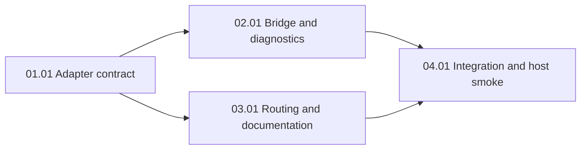

# Codex and Claude Workflow Discovery

## Outcome

Expose all 12 canonical workflows as thin, host-native project skills in Codex and Claude Code, and keep action-sensitive selection from ordinary requests. An entry must load its canonical workflow and retain its inputs, gates, and stop conditions. This artifact plans the work; it does not implement it.

## Pre-planning record

The released discovery brief is fresh and has no material unknowns (`node scripts/context.mjs handoff:verify-brief docs/discovery/codex-claude-workflow-discovery/brief.md`). Grounding packets G-WF-001–003 found KISS/YAGNI support for thin adapters but no canonical Wiki contract for host discovery. Repository source, ADR 0003, ADR 0038, and official host documentation supply that boundary. The user chose both implicit selection and visible native entries, canonical workflows with thin adapters, and Codex `/skills` or `$name` plus Claude Code `/name`.

Current evidence: `context-manifest.json` lists 12 workflows and 18 skills; `scripts/context-core.mjs` selects a workflow after action detection and a routing hint or relevance threshold. `app/cli/core/bridge-generator.mjs` creates per-skill `.agents` links only in its Antigravity/Gemini path, treats any `.agents` directory as Antigravity, and falls back to the local factory when a declared factory path is absent. `verifySymlinkHealth` audits legacy `.agents` links without Claude workflow entries. `app/cli/core/indexer.mjs` generates a misleading “Session Slash Commands” heading. `evals/tests/bridge/bridge-conformance.test.mjs` exercises bridge contracts but not workflow discovery.

### Actors and goals

| Actor | Goal |
| --- | --- |
| Codex or Claude Code developer | Find a named workflow entry and follow the canonical lifecycle. |
| Developer using ordinary language | Get an appropriate workflow only when a task calls for one. |
| Factory and host maintainer | Install, audit, repair, and remove only owned entries without harming host files. |

### Domain language

A *canonical workflow* is a `workflows/*.md` lifecycle contract inventoried in `context-manifest.json`. An *entry* is a thin host skill that points to one canonical workflow and invokes the resolver for the actual request. A *resolver alias* is an internal text trigger, not a host-registered slash command. *Factory health* and *live host behavior* have separate evidence.

### Language stack and applicable rules

The implementation stack is Node ESM JavaScript, Markdown, and JSON. Applicable global evidence, code-quality, architecture, and security directives are bound per unit with current source hashes. TypeScript-only directives are not applied to JavaScript files. The plan's SOLID audit requires one canonical policy owner (SRP), adapters depending on workflow contracts (DIP), deterministic extension from the manifest instead of copied lists (OCP), small entry and bridge interfaces (ISP), and interchangeable entry behavior for every inventoried workflow (LSP). Each execution unit recompiles a fresh `context-cli preflight` binding and obtains a `PASS` conformance receipt; planning hashes are not execution receipts.

### Scenario coverage

| ID | Actor and situation | Expected outcome | Failure/recovery | Unit |
| --- | --- | --- | --- | --- |
| S-01 | Developer browses or invokes any of 12 entries | Unique Codex and Claude entry loads canonical file | Missing/duplicate/broken entry fails inventory audit | 01.01, 04.01 |
| S-02 | Developer makes actionable ordinary request | Resolver selects justified workflow | Direct question or ambiguous text does not force selection | 03.01 |
| S-03 | Host setup repeats or runs concurrently | Owned entries are stable and collision-safe | Preserve unowned file, report collision and repair action | 02.01 |
| S-04 | Factory target moves or disappears | Diagnostics report broken target and repair path | No fallback to unrelated local checkout | 02.01 |
| S-05 | Host skills exist in `.agents` | Codex discovery works | Antigravity identity is not inferred from `.agents` alone | 02.01 |
| S-06 | Maintainer claims delivery | Distinct factory and live-host evidence | Missing live invocation or gate evidence stays unresolved | 04.01 |

### Decision ledger

| ID | Decision | Evidence / effect |
| --- | --- | --- |
| D-01 | `workflows/*.md` remains the single lifecycle policy source; adapter names use `workflow-<canonical-slug>`. | ADR 0003 and 0038; avoids collisions with existing skills and duplicate gates. |
| D-02 | Source adapters live under a new `skills/workflow-entries/workflow-<slug>/SKILL.md` path, inventoried as skills; host links point to these sources. | Existing manifest and bridge discover skill directories; deterministic mapping can be validated. |
| D-03 | Codex uses `.agents/skills`, Claude Code uses `.claude/skills`; internal aliases remain documented as resolver inputs. | User choice and official host docs; deprecated Codex custom prompts excluded. |
| D-04 | Bridge writes only absent or proven-owned entries, rechecks immediately before mutation, and reports collisions; repair uses ownership metadata. | ADR 0038 and S-03/S-04. |
| D-05 | Live host selection, invocation, and canonical gate behavior are separate from `doctor` and link existence. | ADR 0038 and S-06. |

## Unknowns and blockers

None for planning. Exact host UI behavior and skill-list truncation require execution-stage live smoke checks; if a host cannot expose all entries, record that as a delivery blocker rather than declaring completion.

## Acceptance criteria

| ID | Source goal/scenario/decision | Criterion | Implementation unit | Verification |
| --- | --- | --- | --- | --- |
| AC-01 | S-01, D-01 | Each of 12 manifest workflows has one unique thin adapter and valid Codex and Claude factory entry; absent, duplicate, stale, and broken entries fail inspection. | 01.01, 04.01 | `node --test evals/tests/bridge/workflow-entry-contract.test.mjs` |
| AC-02 | S-01, S-06 | Codex `/skills` or `$name` and Claude `/name` each load a canonical workflow and exhibit required input and stop condition. | 04.01 | `node scripts/context.mjs doctor` plus recorded separate live Codex and Claude smoke checks |
| AC-03 | S-02 | Actionable requests select with an inspectable reason; direct questions and ambiguous requests avoid unjustified confident selection. | 03.01 | `node --test evals/tests/bridge/workflow-routing.test.mjs` and `node evals/run-evals.mjs` |
| AC-04 | S-03 | Factory, linked-host, and submodule bridge modes preserve unowned files, report collisions, recheck at write, and rerun idempotently. | 02.01 | `node --test evals/tests/bridge/bridge-conformance.test.mjs` |
| AC-05 | S-04 | Missing/moved factory and broken links produce failing diagnostics and an actionable repair route; cleanup touches only owned entries. | 02.01 | `node --test evals/tests/bridge/bridge-conformance.test.mjs` |
| AC-06 | S-05 | Codex `.agents` setup alone does not classify a host as Antigravity. | 02.01 | `node --test evals/tests/bridge/bridge-conformance.test.mjs` |
| AC-07 | D-01/D-03 | Docs distinguish resolver aliases from native host syntax; entries contain no copied phase or gate policy. | 01.01, 03.01 | `node --test evals/tests/bridge/workflow-entry-contract.test.mjs`; `node scripts/context.mjs doctor` |
| AC-08 | S-06 | Manifest, maps, lock, validation, resolver evals, bridge tests, and doctor agree; factory and host results reported separately. | 04.01 | `npm run sync`; `npm run lock`; `node scripts/context.mjs doctor`; `node evals/run-evals.mjs` |

## Scope

New thin adapter files and host links; manifest/validator/indexer inventory; bridge generation, diagnostics, and focused tests; resolver selection and evaluation cases; documentation and live smoke evidence. Files marked *new* in units do not yet exist. No application API or database migration.

## Non-goals

No conversion of full workflows into skills, second gate owner, deprecated Codex custom prompts, other editor adapters, consumer application feature changes, automatic execution/push/release/waiver/message authority, or remote release.

## Constraints and decisions

A selected entry must resolve the actual user request and read the selected `workflows/*.md`, not assume invocation grants release authority. Host files with no ownership proof remain untouched even under repair. Do not use `force` as a blanket overwrite mechanism. Any expanded inventory must remain deterministic and repairable from the manifest. Keep generated docs generated by changing their source in `app/cli/core/indexer.mjs`.

## Risk and dependency register

| Risk or dependency | Impact | Mitigation or owner |
| --- | --- | --- |
| Existing `createRelativeSymlink` can replace a different symlink, and `repairBridgeSymlinks` uses force | User content loss | Unit 02.01 adds ownership checks and collision tests before mutation. |
| Declared host factory path can fall back to local root | Broken host may appear healthy | Unit 02.01 removes that silent fallback for workflow entry targets. |
| Adding 12 skills may shorten Codex's initial list | Entry discoverability cannot be inferred from files | Unit 04.01 measures list size and performs live browse/invocation checks. |
| Resolver's action test and rank threshold can overselect or underselect | Wrong lifecycle | Unit 03.01 includes positive, direct-question, ambiguous negative cases and reasons. |
| Shared manifest/maps/lock touched across units | Drift or conflicts | Execute serially on one branch; Unit 04.01 resynchronizes and validates whole inventory. |
| Host version or UI changes | Native invocation differs | Recheck official host syntax at execution and record observed live behavior. |

## Dependency graph and phases

02.01 and 03.01 have no dependency edge between them; execute them serially on this task branch because the checkout is shared. Phase numbers give a preferred checkpoint order, not an authorization to skip a dependency. Each phase is reviewed before continuing.

| Phase | Goal | Units | Checkpoint |
| --- | --- | --- | --- |
| 01 | Canonical adapter contract and factory discovery | 01.01 | Inventory and entry contract tests |
| 02 | Bridge installation and diagnostics | 02.01 | Host fixture and collision tests |
| 03 | Ordinary request routing and documentation | 03.01 | Resolver evaluations and generated docs |
| 04 | Whole-diff verification and host behavior | 04.01 | Factory checks plus separate live host receipts |

## Task branch

| Field | Verified value |
| --- | --- |
| Target base | `master` |
| Task branch | `feat/PLN-0009-codex-and-claude-workflow-discovery` |
| Base commit | `fa8f5db00cb0d113589190ed15d6752ab3612831` |
| Checkout model | One branch; serial units; no push implied. |

## Verification

Planning: released brief, branch/base check, `node scripts/context.mjs plan:check docs/tasks/2026/10/2026-10-11/feat-PLN-0009-codex-and-claude-workflow-discovery`, and `git diff --check`. Implementation checks listed in each unit are pending. Final integration requires a fresh whole-diff preflight/conform PASS receipt, independent review, focused and full evaluations, doctor, and separate live Codex and Claude smoke evidence. Stop on FAIL or BLOCKED; do not infer host behavior from doctor.

## Deviations

The scaffold's master file was moved into the task directory as `README.md` so `plan:check` can validate the task contract.

## Plan done-check

- [x] Acceptance criteria map to units and concrete verification.
- [x] Material blockers are resolved or absent.
- [x] Risks, dependencies, scope, and rollback are recorded.
- [x] Task branch checkout and target base are verified.

## Finalization & Merge Ledger

| Stage | Branch / target | Required evidence | State |
| --- | --- | --- | --- |
| Plan review | task branch | brief, `plan:check`, independent review and approval | passed |
| Each unit | task branch | failing behavior test first, exact scope, focused checks, fresh preflight/conform PASS, review | passed |
| Each phase | task branch | unit commits and phase checkpoint evidence | passed |
| Finalization | task branch → `master` | full acceptance, inventory/lock, evaluations, doctor, whole-diff PASS, live host receipts | passed |
| Integration | `master` | separately authorized merge and post-merge health | pending |

## Result

Phases 01 through 04 completed and verified on `feat/PLN-0009-codex-and-claude-workflow-discovery`. All 12 canonical workflows are exposed as thin adapters under `skills/workflow-entries/`, linked into `.agents/skills` and `.claude/skills`. Full factory test suite, evaluations, and doctor pass (HEALTHY). OpenAI Codex CLI live host invocation verified. Claude Code live host invocation recorded as pending authentication login. Ready for merge upon explicit authorization.
