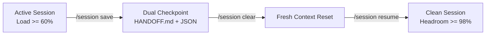

# Session State Persistence & Clean-Context Resume

Long conversations degrade agent performance: attention spreads across old turns, constraints get forgotten, and failed approaches get retried. The solution is to write essential task state to disk, start a fresh context, and reload only that state. This skill defines how to persist state (`HANDOFF.md` and machine checkpoints), clear ephemeral context, and resume execution cleanly.

## Mental Model & The 60% Saturation Rule

Context window degradation occurs when cumulative conversation history consumes >60% of an LLM's effective context window. Above this threshold, reasoning precision, rule adherence, and code quality degrade substantially.

To maximize output fidelity while minimizing input tokens:
- Monitor conversation context saturation during iterative development.
- When context load approaches **~60% saturation**, trigger `/session save` to snapshot machine state and generate `HANDOFF.md`.
- Run `/session clear` to reset ephemeral session pointer files and prepare a clean slate.
- Clear the conversation context or open a fresh thread, and invoke `/session resume` to re-hydrate state with 98%+ clean context headroom.



## Slash Commands & CLI Equivalence

| Slash Command | CLI Subcommand | Purpose |
| :--- | :--- | :--- |
| `/session save` | `node scripts/context.mjs session:save` | Snapshot task, phase, unit, git status, write `HANDOFF.md` and `.context/sessions/<id>.json` |
| `/session resume` | `node scripts/context.mjs session:resume [id]` | Load checkpoint, read `HANDOFF.md`, and display cold-start prompt |
| `/session status` | `node scripts/context.mjs session:status` | Display table of persisted sessions, branches, and timestamps |
| `/session clear` | `node scripts/context.mjs session:clear [id]` | Clear ephemeral session pointers (`.tmp/SESSION_RESUME.md`) while preserving `HANDOFF.md` |

## Canonical Handoff Structure (`HANDOFF.md`)

When saving session state, `HANDOFF.md` is generated in the workspace root following the canonical template in `docs/templates/Handoff.md`. It documents exactly six structured sections:

1. `# Goal - what we're trying to build`: Concise description of the active task, user brief, plan ID, unit ID, and binary done criteria.
2. `## Current State - where the work stands right now`: Authoritative branch name, HEAD commit SHA, verification status, and blockers requiring user decisions.
3. `## Files in flight - active files being modified`: Repository-relative paths of files currently modified or half-done that the resuming agent must inspect.
4. `## Changes - what's been touched this session`: Summary of modifications and architectural decisions with rationale (describing the delta, not raw diffs).
5. `## Failed attempts - why didnt work and why`: Explicit record of approaches tried that failed, error messages encountered, root causes, and `Retry only if` conditions to prevent retry loops.
6. `## Next steps - the single next thing to try`: The single concrete, actionable next step and its expected result.

## Lifecycle Procedures

### 1. Saving Active Session State (`/session save`)

Execute before reaching high context saturation or pausing multi-unit tasks:

1. Reach a stable point. Run relevant verification commands so verification records a real outcome.
2. Run the session save command:
   ```bash
   node scripts/context.mjs session:save --task "0001" --phase "03" --unit "03.01" --status "in_progress"
   ```
3. The engine automatically:
   - Validates state against `schemas/session-state.schema.json`.
   - Writes durable machine checkpoint to `.context/sessions/<session-id>.json`.
   - Generates the markdown handoff in `HANDOFF.md` (modeled after `docs/templates/Handoff.md`).
   - Generates condensed briefing in `.tmp/SESSION_RESUME.md` (<1,500 tokens).
4. Direct the user to reset conversation context for a clean start.

### 2. Clearing Session Pointers (`/session clear`)

Before resuming or after finishing a task unit, reset ephemeral pointers:

```bash
# Clear active session pointer (retains HANDOFF.md)
node scripts/context.mjs session:clear --active

# Clear all historical checkpoints and remove HANDOFF.md when task is finished
node scripts/context.mjs session:clear --all --with-handoff
```

### 3. Resuming in a Clean Session (`/session resume`)

When beginning a new session or resuming after a context reset:

1. Invoke resume:
   ```bash
   node scripts/context.mjs session:resume
   ```
2. Inspect `HANDOFF.md`:
   - Verify task identity, goal, and branch.
   - Review files in flight and avoid repeating failed attempts.
   - Validate git HEAD and dirty count against recorded state.
3. Execute the single next step specified in `## Next steps` without re-reading extensive raw past transcripts.

### 4. Inspecting Status (`/session status`)

To audit active sessions across branches:

```bash
node scripts/context.mjs session:status
```

Outputs a structured table listing Session ID, Task ID, Phase, Unit, Git Branch, and Last Updated timestamp.

## Guardrails & Best Practices

- **Zero Secrets:** Never serialize passwords, API keys, or raw tokens into `.context/sessions/` or `HANDOFF.md`.
- **Lightweight Briefings:** Keep handoffs and resume briefings compact (<1,500 tokens). Never dump full source files into session state.
- **Exact Branch Alignment:** Before saving or resuming active plan work, verify the recorded task branch matches the current branch.
- **Canonical Template:** Use `docs/templates/Handoff.md` as the authoritative template definition.
